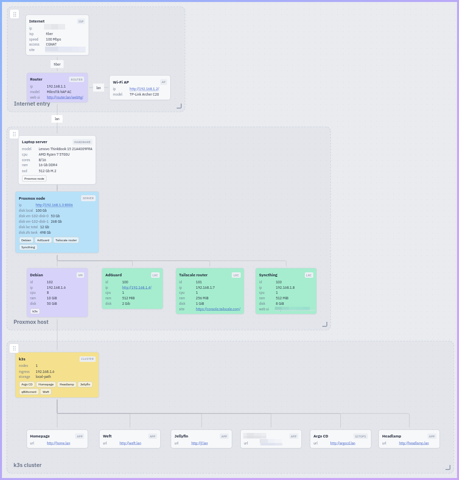
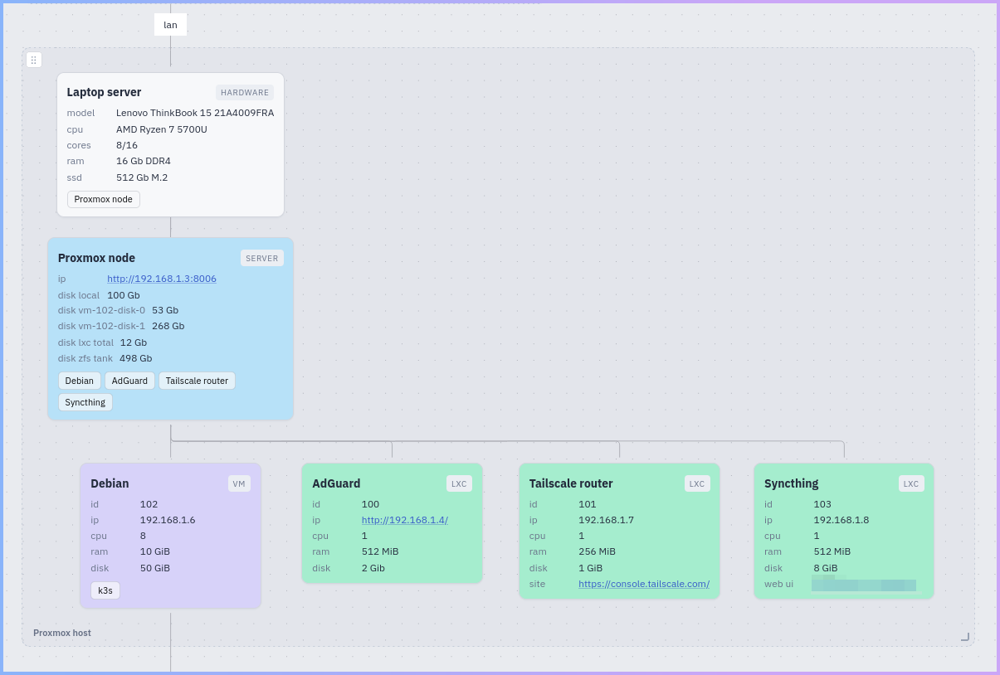
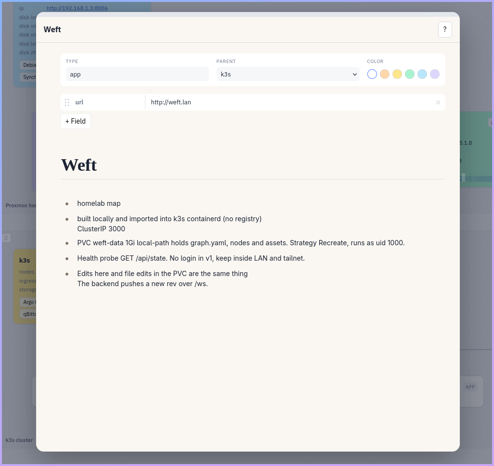

# Weft

Small single user homelab map. Canvas of nodes plus notes pages. All state is text files. No database exists. No login exists in v1, so keep the app inside your tailnet.



## Layout

- `frontend/` is Svelte 5 plus Svelte Flow plus TypeScript. It builds a static SPA.
- `backend/` is Rust plus Axum. It serves the SPA and a JSON API. It reads and writes `data/`.
- `Dockerfile` plus `.dockerignore` build a self-contained image. See Container image.
- `seed/` holds sample data. Copy it to `data/` on first setup.
- `data/` holds live state and stays out of git. `data/graph.yaml` holds areas, node positions, parents, edges. `data/nodes/*.md` holds one node each. Top block holds id, title, type, color, fields. Body is Markdown notes. `data/assets/` holds uploaded images, served under `/uploads/`.

## First run on any machine

You need Node 22 and stable Rust.

```
cp -r seed data
cd frontend && npm install && npm run build
cd ../backend && DATA_DIR=../data PORT=3000 cargo run --release
```

Open `http://127.0.0.1:3000`.

Two env vars control the backend. `PORT` picks the listen port. Default is 3000. `DATA_DIR` picks the state folder. Default is `data`.

## Dev with hot reload

```
# shell 1
cd backend && DATA_DIR=../data PORT=3000 cargo run
# shell 2
cd frontend && npm run dev
```

Open the vite URL. API calls proxy to `:3000`.

## Production run

Build the frontend once and run the release binary. Keep `data/` on a backed up disk. It holds everything.

```
cd frontend && npm install && npm run build
cd ../backend && cargo build --release
mkdir -p /srv/weft && cp -r ../frontend/dist /srv/weft/public
cp target/release/weft /srv/weft/weft
if [ ! -f /srv/weft/data/graph.yaml ]; then cp -r ../seed /srv/weft/data; fi
DATA_DIR=/srv/weft/data PORT=3000 /srv/weft/weft
```

Copy the seed only on first setup. Never copy it over a live `data/` folder.

The backend finds the SPA in `./public`, `/app/public`, `frontend/dist`, or `../frontend/dist`. These paths are relative to your start folder, so a systemd unit needs `WorkingDirectory`. A simple unit for autostart:

```
[Unit]
Description=Weft homelab map
After=network.target

[Service]
User=weft
WorkingDirectory=/srv/weft
Environment=DATA_DIR=/srv/weft/data PORT=3000
ExecStart=/srv/weft/weft
Restart=on-failure

[Install]
WantedBy=multi-user.target
```

Put a reverse proxy in front for TLS. There is no auth in v1. The backend always listens on `0.0.0.0:PORT` and has no localhost-only option, so restrict access at the proxy or firewall, or serve only inside your tailnet.

## Container image

The repo ships a `Dockerfile`. Build it from the repo root:

```
docker build -t weft:0.1.0 .
docker run --rm -p 3000:3000 -v weft-data:/data weft:0.1.0
```

First start seeds `/data` from the sample. Later starts keep the volume. The image runs as non-root user `app` and writes to `/data`, so the mount must be writable by uid 1000.

Any orchestrator must mount writable storage at `/data` for uid 1000, and use `GET /api/state` for health checks. The backend has no `/health` endpoint. There is no auth in v1, so keep the app inside your tailnet.

## Use



- Drag cards to move them. Drag between the dots on cards to link them.
- Right click empty canvas to add a node or area at that spot.
- Double click a card, or its notes button, to open notes in a popover.
- Delete key removes the picked node, area, or edge.
- Press `?` for all keyboard shortcuts. `Ctrl+Z` undoes a delete.
- Areas move by the top left grip and resize by the bottom right grip only.
- Search lives on the island at the top left of the canvas. Slash focuses it. Enter with one match opens its notes.
- Notes use a Markdown editor with autosave. Paste images straight in.
- Nodes take one of five pastel colors from the dots on top of the notes popover.



## AI file edits

- Move a node: edit `x` and `y` under `data/graph.yaml`.
- Rename a node: edit `title` in `data/nodes/<id>.md`.
- Change fields: edit `fields` in the same file.
- Add a node: add one entry in `graph.yaml` plus one file in `nodes/`.
- Add an edge: add one entry under `edges` in `graph.yaml`.
- The backend picks up disk changes and pushes a new `rev` over `/ws`.

## License

Copyright (C) 2026 rythm.

Weft is free software. You can redistribute it and change it under the GNU General Public License version 3. The full text is in `LICENSE`.
